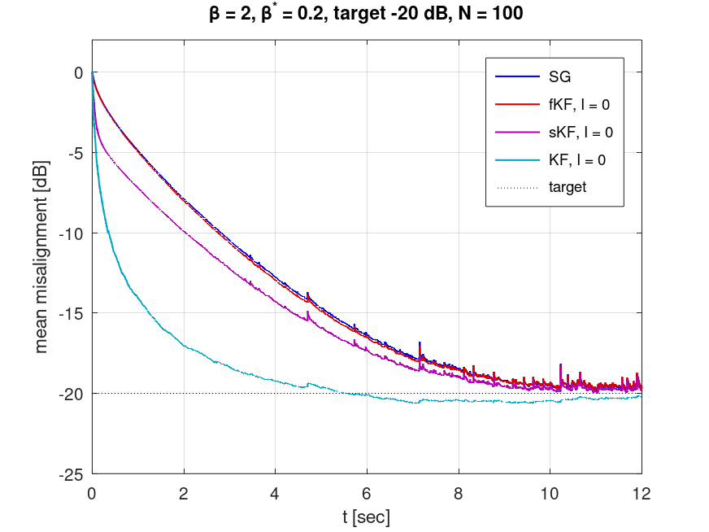
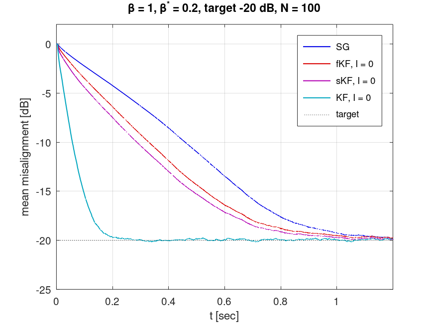

# Bayesian adaptive filters in MATLAB/Octave

An independent reimplementation, for study purposes, of the numerical examples of

> L. Szczecinski, J. Benesty, E. V. Kuhn, "A unified Bayesian perspective for conventional and
> robust adaptive filters", *Signal Processing* 238 (2026) 110189.

The paper derives LMS, regularized NLMS, the broadband Kalman filter and the Kalman filter, plus
their robust counterparts, from one Bayesian recursion. This repository implements that recursion
in MATLAB/Octave, reproduces Figs. 3 and 4 of the paper with its published parameters, and checks
the result three ways: against the published curves, against an earlier Python reproduction
([bayes-robust-adaptive-filtering](https://github.com/Ramirouf/bayes-robust-adaptive-filtering))
on identical signals, and against closed-form results.

<p align="center">
  
  
</p>

*Same target (-20 dB), same heavy-tailed noise. Left: conventional filters, which assume Gaussian
noise (12 s axis). Right: robust filters, which assume Laplacian noise (1.2 s axis). The robust
filters reach the target about 10x sooner.*

## The filters

Every filter is the same recursion, `w_t = w_{t-1} + kappa_t alpha_t e_t`, with
`alpha_t = 1 / (tau |e_t|^(2-beta) + s_t)` (Eqs. 29, 32, 75). The variants differ only in how much
of the posterior covariance they keep; `beta` is the noise shape the filter assumes.

| Variant | Covariance kept | `beta = 2` (Gaussian) | `beta = 1` (Laplacian, robust) | Knob |
|---|---|---|---|---|
| SG | none | LMS | sign-error LMS | `mu` |
| fKF | fixed scalar | regularized NLMS | regularized normalized sign-error LMS | `tau/v` |
| sKF | scalar | broadband Kalman filter | its sign-error version | `eps` |
| vKF | diagonal | per-tap variance version of sKF | same, robust | `eps` |
| KF | full matrix | Kalman filter | robust Kalman filter | `eps` |

All five, for any `beta` and any number of gain iterations `I` (Eqs. 37-40), are in one file,
[`+af/run_filter.m`](+af/run_filter.m), with the paper's equation number on each update.

## The experiment (Sec. 4 of the paper)

- Identify a 128-tap room impulse response (Fig. 2) from `y_t = x_t' h + eta_t`.
- Input: AR(1), `x_t = -0.9 x_{t-1} + u_t`. Noise: generalized Gaussian with shape `beta* = 0.2`
  (excess kurtosis about 1,960, against 3 for Laplacian), at an output SNR of 5 dB.
- Metric: misalignment `||w_t - h||^2 / ||h||^2`, averaged over N = 100 realizations.
- Protocol: every filter's knob is set so that all filters reach the **same** target misalignment;
  what is compared is how fast they get there. Knobs: Tables 1 and 2 of the paper, verbatim.

What the paper leaves unstated, and what is used here ([DECISIONS.md](DECISIONS.md) has the
reasoning):

| Not stated in the paper | Used |
|---|---|
| Settings of the impulse-response generator | `rir-generator` (the software the paper cites), c = 340 m/s, high-pass on: the setting that reproduces Fig. 2. Not normalized. |
| Variance `v_u` of the AR(1) driving noise | 1 |
| Prior variance `v_0` of the Kalman family | `\|\|h\|\|^2 / M` |
| `tau` at `beta = 1` | from the general Eq. (69); Eq. (80) is off by 2x (see Notes) |
| vKF knob (vKF is not in the figures) | the sKF value |
| Run lengths | read off the axes of Figs. 3 and 4 |

## Results

All 29 curves of Figs. 3 and 4 settle within 0.8 dB of their target with the published knobs
([`results/summary.csv`](results/summary.csv); Octave, N = 100). Convergence time below is the
first time the curve is within 1 dB of its own final floor.

**Fig. 3: conventional against robust, target -20 dB**

| Filter (`beta = 2` / `beta = 1`) | Floor, `beta = 2` | Floor, `beta = 1` | Converged, `beta = 2` | Converged, `beta = 1` | Speed-up |
|---|---|---|---|---|---|
| SG (LMS / sign-error LMS) | -19.60 dB | -19.63 dB | 8.13 s | 0.90 s | **9.1x** |
| fKF (regularized NLMS / its robust form) | -19.54 dB | -19.68 dB | 7.99 s | 0.79 s | **10.1x** |
| sKF (broadband Kalman / its robust form) | -19.75 dB | -19.82 dB | 7.51 s | 0.74 s | **10.1x** |
| KF (Kalman / robust Kalman) | -20.30 dB | -19.90 dB | 4.10 s | 0.16 s | **26.2x** |

**Fig. 4: robust filters at three targets, without (`I = 0`) and with (`I = 1`) one extra gain iteration**

| Converged at | -15 dB, I = 0 | I = 1 | -20 dB, I = 0 | I = 1 | -25 dB, I = 0 | I = 1 |
|---|---|---|---|---|---|---|
| SG | 0.51 s | | 0.90 s | | 1.62 s | |
| fKF | 0.46 s | 0.41 s | 0.79 s | 0.71 s | 1.54 s | 1.39 s |
| sKF | 0.45 s | 0.40 s | 0.74 s | 0.66 s | 1.37 s | 1.20 s |
| KF | 0.098 s | 0.084 s | 0.156 s | 0.130 s | 0.258 s | 0.230 s |

Figures: [4a](figures/fig4a.png), [4b](figures/fig4b.png), [4c](figures/fig4c.png).

This reproduces what the paper reports: the robust filters converge about ten times faster; keeping
more of the covariance is faster (KF, then sKF, fKF, SG); at `beta = 2` the model mismatch hides
most of that benefit (fKF and sKF barely beat SG in Fig. 3a); and one extra gain iteration helps
modestly, shortening convergence by 9-17% in every case above.

## Verification

**1. Against the published figures.** The paper puts markers on the fKF, sKF and KF curves of
Figs. 3a and 3b. [`data/digitize_fig3.py`](data/digitize_fig3.py) reads all 27 off a 400 dpi
render of the paper; [`verify/compare_paper.m`](verify/compare_paper.m) compares our curves at the
same times.
**Largest gap 0.52 dB; within 0.2 dB at every marker while the curves are still falling.**

**2. Against the Python reproduction, on identical signals.**
[`verify/export_reference.py`](verify/export_reference.py) runs the Python code and saves its exact
input and noise; [`verify/compare_python.m`](verify/compare_python.m) feeds the same signals to
`af.run_filter` and compares the weight vectors (every 100 samples) and the misalignment (every
sample) over 14 configurations. Tolerance 1e-9.

```
  variant  beta   I        err_w        err_m   result
  SG          2   0     7.07e-16     2.77e-15   PASS
  fKF         2   0     1.20e-15     2.74e-15   PASS
  sKF         2   0     1.65e-15     3.07e-15   PASS
  vKF         2   0     1.65e-15     2.64e-15   PASS
  KF          2   0     8.43e-16     2.18e-15   PASS
  SG          1   0     0.00e+00     2.63e-15   PASS
  fKF         1   0     1.56e-15     5.30e-15   PASS
  sKF         1   0     1.26e-15     3.75e-15   PASS
  vKF         1   0     8.73e-16     4.86e-15   PASS
  KF          1   0     6.93e-16     5.45e-15   PASS
  fKF         1   1     9.27e-16     4.89e-15   PASS
  sKF         1   1     1.20e-15     6.24e-15   PASS
  vKF         1   1     1.41e-15     3.65e-15   PASS
  KF          1   1     1.53e-15     1.10e-14   PASS

  largest gap over all configurations: 1.10e-14 (tolerance 1e-09)
```

`err_w` is `max_k ||w_k - w_k^Python||_inf / ||w_k^Python||_inf`. In MATLAB R2026b the largest gap
is 9.0e-15. The check was itself tested by planting six bugs, among them `e_{t,i}` instead of
`e_{t,0}` in Eq. (38), `tau` taken from Eq. (80), and a wrong Table 2 entry. Each one failed
exactly the configurations it affects.

**3. Against exact results** ([`verify/check_model.m`](verify/check_model.m)). With Gaussian noise
and `eps = 0`, the KF must return the closed-form Bayesian posterior mean
`(X'X + v_eta/v_0 I)^-1 X'y`: it does, to 4e-15. The noise sampler passes a Kolmogorov-Smirnov
test against the exact distribution at `beta* = 0.2, 1, 2`, and the impulse response has the peak
of Fig. 2 (0.0501 at tap 33).

## Run

No toolboxes needed.

```
octave --no-gui run_all.m        % Octave
run_all                          % MATLAB
QUICK = true; run_all            % N = 10 instead of 100, for MATLAB Online's 15-minute limit
```

`run_all` runs the checks, the cross-validation, Figs. 3-4 and the comparison with the paper, and
writes `figures/` and `results/`.

| Tested on (Apple M1) | Full run, N = 100 | Result |
|---|---|---|
| GNU Octave 11.3 | 17 min (8.5 of them for the KF of Fig. 3a) | all checks pass |
| MATLAB R2026b, no toolboxes installed | 4.3 min | all checks pass; Code Analyzer reports no issues |

Octave and MATLAB draw different random numbers from the same seed, so their curves agree
statistically (MATLAB: largest gap to the paper 0.45 dB, speed-ups 9.1x / 10.4x / 10.2x / 26.4x),
not bit for bit. Bit-level agreement is only claimed against Python, on shared signals.

To regenerate the Python reference or the digitized markers:

```
PYTHONPATH=/path/to/bayes-robust-adaptive-filtering python verify/export_reference.py
python data/digitize_fig3.py /path/to/paper.pdf      # needs pdftoppm, numpy, scipy, pillow
python data/make_h.py                                # needs rir-generator
```

## Notes

- **Why compare speed and not accuracy.** A larger step always converges faster and settles
  higher. Comparing filters at different floors therefore says nothing; here every filter is tuned
  to the same floor, as in the paper, and only the time to reach it differs.
- **Eqs. (77) and (80) are off by a factor of 2.** Both follow from the general Eqs. (66) and (69)
  with `kappa(1) = sqrt(2)`, but Eq. (61) gives `kappa(1) = 1/sqrt(2)`. The code uses the general
  forms; `verify/check_model.m` asserts `tau(beta = 1) = sigma / sqrt(2)`.
- **Why the paper's impulse-response generator matters.** With a re-implemented image-source
  response of the same room instead, the same code reaches -18 dB in Fig. 3a's KF 1.2x later
  (3.46 s against 2.86 s). That accounts for most of what had kept the earlier Python
  reproduction from matching that curve.
- **Implementation.** The full-covariance KF loops over realizations with a 2-D covariance
  matrix: in Octave (no `pagemtimes`) that is about 2x faster than a 3-D array over all
  realizations. The other variants process all realizations at once, as matrix columns.

## Layout

```
run_all.m                    checks, cross-validation, Figs. 3-4, comparison with the paper
+af/run_filter.m             the recursion: SG, fKF, sKF, vKF, KF, for any beta and I
+af/                         noise model, gamma sampler, AR(1) input, SNR, Tables 1-2
sim/                         one panel of Fig. 3 or 4: run, plot, save
verify/check_model.m         checks against the paper and closed-form results
verify/compare_python.m      cross-validation against the Python reproduction
verify/compare_paper.m       our Figs. 3a-3b against the markers of the published figures
verify/export_reference.py   writes verify/reference/ from the Python code
data/h.csv                   the room impulse response of Fig. 2 (data/make_h.py)
data/paper_fig3_markers.csv  markers read off the paper's Figs. 3a-3b (data/digitize_fig3.py)
figures/, results/           output of run_all (Octave, N = 100)
DECISIONS.md                 what was decided and why, including values the paper leaves unstated
```

## License

MIT. The paper itself is not included.
